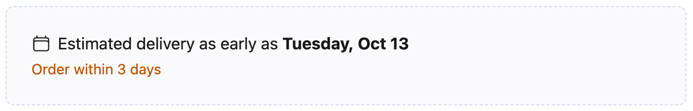
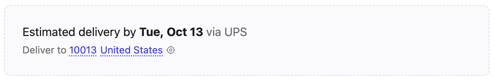

# Promise UI

Open-source reference implementation of an embeddable delivery promise widget for retailer product detail pages, cart summaries, and checkout flows. Displays estimated delivery dates, courier options, and order cutoff urgency — powered by the [parcelLab Promise API v2](https://docs.parcellab.com/docs/developers/v2/promise/promise-dates).

Use this widget as-is, or as a starting point for building your own custom integration against the API.

**[Live demo](https://cdn.parcellab.com/playground/promise-ui/index.html)**

## Overview

The widget fetches delivery predictions for a given destination and account, then renders a compact, customizable UI that shows:

- **Delivery date** — the earliest, most likely, or latest date for the selected delivery method
- **Date range** — earliest to latest estimated delivery window
- **Courier name** — which carrier handles the shipment (DHL, UPS, etc.)
- **Order cutoff** — the order window supplied by the API, such as "Order within 2 hours"
- **Primary delivery option** — selects one delivery method from the available predictions
- **Optional IP Fetch** — estimates the country and postal code before the shopper enters a destination

It ships as a zero-dependency bundle in two formats:

| Format | File | Use case |
|--------|------|----------|
| IIFE | `dist/promise.iife.js` | `<script>` tag embeds — auto-initializes from `data-*` attributes |
| ESM | `dist/promise.esm.js` | Module bundlers and `import` consumers |

## Recommended usage

Use these examples as starting points for product detail pages (PDPs) and checkout. Replace account `1612197` with your account ID. Set `data-country` to the ISO3 code for your main customer market, such as `DEU` for Germany. It supplies the fallback when IP resolution fails or no delivery method matches the resolved location.

If you already have a delivery address, for example from a logged-in shopper, set `data-postal-code` to its ZIP and `data-country` to its country. A known ZIP takes priority over IP Fetch. Leave the ZIP empty to use IP resolution and country fallback.

The screenshots show example predictions. Dates, cutoff times, carriers, and locations depend on the response for the shopper's destination.

### PDP: minimal estimate with cutoff

Use IP Fetch to estimate the destination before an address is known. Keep the ZIP and country controls hidden to make the widget small. The estimate still uses the known, resolved, or fallback destination. Show the earliest estimated delivery date and the order cutoff to create urgency, without a carrier name.



```html
<div
  data-promise
  data-account-id="1612197"
  data-country="DEU"
  data-postal-code=""
  data-ip-fetch="true"
  data-layout="text"
  data-date-mode="from"
  data-zip-picker="none"
  data-country-picker="false"
  data-show-cutoff="always"
  data-locale="en"
  data-icon="calendar"
  data-confidence="estimated"
  data-date-format="long"
  data-show-carrier="none"
  data-require-zip="false"
  data-selection-reference-date="earliest"
  data-selection-pick="earliest"
></div>
<script src="https://cdn.parcellab.com/js/promise-ui/v1/promise.iife.js" defer></script>
```

### Checkout: editable location with delivery-by date

Show the ZIP and country returned by IP resolution and let the shopper change them. The icon marks an approximate location. If no ZIP is available, the widget shows the country and **Add ZIP**. When the checkout already has an address, supply that ZIP and country instead.

Show the selected delivery method's latest estimated arrival date with "delivery by" wording and the carrier name. Hide the cutoff because the shopper is already in checkout.



```html
<div
  data-promise
  data-account-id="1612197"
  data-country="DEU"
  data-postal-code=""
  data-ip-fetch="true"
  data-layout="text"
  data-date-mode="by"
  data-zip-picker="inline"
  data-country-picker="true"
  data-show-cutoff="never"
  data-locale="en"
  data-icon="none"
  data-confidence="estimated"
  data-date-format="short"
  data-show-carrier="inline"
  data-require-zip="false"
  data-selection-reference-date="earliest"
  data-selection-pick="earliest"
></div>
<script src="https://cdn.parcellab.com/js/promise-ui/v1/promise.iife.js" defer></script>
```

Both examples select the delivery method with the earliest `earliest` date. `data-date-mode="from"` displays that method's earliest date; `data-date-mode="by"` displays its latest date. See [Selecting the Primary Prediction](#selecting-the-primary-prediction) to change which method is selected.

For local testing, replace the script URL with `http://localhost:4174/dist/promise.iife.js` and run the [development server](#development).

## Quick Start

### HTML Embed (simplest)

```html
<div
  data-promise
  data-account-id="YOUR_ACCOUNT_ID"
  data-country="DEU"
  data-ip-fetch="true"
  data-zip-picker="inline"
  data-country-picker="true"
></div>

<script src="https://cdn.parcellab.com/js/promise-ui/v1/promise.iife.js" defer></script>
```

The IIFE build auto-initializes every `[data-promise]` element when the DOM is ready. Each element needs an account ID and country. Elements missing either attribute are skipped with a console warning. For elements added later, call `window.DeliveryPromise.autoInit()` after adding them to the DOM.

### JavaScript API

Load the IIFE script first and provide an existing target element, such as `<div id="delivery-promise"></div>`. For a bundler, import `init` from `@parcellab/promise-ui` and call `init(config)`; the ESM build does not auto-initialize elements.

```js
const widget = window.DeliveryPromise.init({
  target: '#delivery-promise',
  accountId: 1612197,
  destinationCountry: 'DEU',
  ipFetch: true,
  locale: 'de',
  layout: 'text',
  dateMode: 'range',
  showCutoff: 'auto',
  showCarrier: 'inline',
  icon: 'truck',
  zipPicker: 'inline',
  countryPicker: true,
  theme: {
    accentColor: '#3D3AD3',
    urgentColor: '#F4373D',
    radius: '12px',
  },
  messages: {
    deliverTo: 'Lieferung nach',
  },
});

// Update for a different destination without re-mounting
widget.update({ destinationCountry: 'FRA', postalCode: '75001' });

// Tear down the widget
widget.destroy();
```

### Location requests and pickers

The widget sends one of these three location requests. The picker behavior below assumes `zipPicker: 'inline'`; `countryPicker` separately controls whether the country is editable.

| Location input | Promise query | Picker behavior |
|----------------|---------------|-----------------|
| ZIP + country | `destination=81549_DEU` | Show the supplied ZIP in the ZIP picker. |
| Country only | `destination=DEU` | Show an empty ZIP picker. |
| IP + fallback country | `destination=8.8.8.8&fallbackCountry=DEU` | Use the ZIP and country from the response. If IP lookup or resolution fails, use the fallback country and an empty ZIP. |

`destinationCountry` is the only country setting. It supplies the country for ZIP and country-only requests, and the `fallbackCountry` query parameter for IP requests.

On initialization, the destination has this priority:

1. A ZIP supplied by the page, with the page's country.
2. An unexpired shopper selection from browser storage, with its saved country. A saved country without a ZIP also skips IP Fetch.
3. IP resolution, if `ipFetch: true`. Use `ipAddress` when supplied; otherwise fetch the public IP.
4. The configured country with an empty ZIP, if IP Fetch is off or the public IP lookup fails.

Picker visibility does not change this priority. Saved selections are loaded on initialization, not on every `update()` or `refresh()`.

### Sample requests

These examples use account `1612197`. The IP addresses are examples; the demo fetches your public IP. Each data preset shows a sample request and updates the preview. Data and presentation presets can be combined.

| Use case | Sample request |
|----------|----------------|
| PDP · Germany, no ZIP | `GET /v2/prediction?user=1612197&destination=DEU&lang=en` |
| PDP · United States, no ZIP | `GET /v2/prediction?user=1612197&destination=USA&lang=en` |
| Checkout · Germany + ZIP | `GET /v2/prediction?user=1612197&destination=81371_DEU&lang=de` |
| Checkout · US + ZIP | `GET /v2/prediction?user=1612197&destination=10038_USA&lang=en` |
| PDP · IP, Germany fallback | `GET /v2/prediction?user=1612197&destination=8.8.8.8&fallbackCountry=DEU&lang=en` |
| PDP · IP, US fallback | `GET /v2/prediction?user=1612197&destination=8.8.8.8&fallbackCountry=USA&lang=en` |
| PDP · IPv6, Germany fallback | `GET /v2/prediction?user=1612197&destination=2001:4860:4860::8888&fallbackCountry=DEU&lang=en` |

For an IP response with a ZIP, the preview shows the ZIP and country with the approximate-location icon. A country-only or fallback response shows the country and **Add ZIP**. Select **ZIP required · PDP** to see the ZIP prompt without a delivery date when the response has no ZIP. Select **Minimal PDP** to hide the location row while keeping the estimate.

### Location display

Set `zipPicker: 'inline'` to show the location row in all three layouts, including loading, no-data, error, and static-fallback states. Set `countryPicker: true` to add an inline country control to that row. It shows only the localized country name, fits the displayed text, and opens the native country menu on click or with the keyboard. ISO3 codes remain in the option values and prediction requests. Country names use the browser's `Intl.DisplayNames`; older browsers show codes. The menu lists countries independently of the account's delivery methods, so selecting a country does not guarantee an available prediction.

Set `zipPicker: 'none'` to hide the entire location row, including the ZIP picker, country dropdown, and automatic-location icon. The widget still uses the supplied, resolved, or fallback country internally. With the row hidden, `requireZip` does not block country-level predictions.

With `countryPicker: false`, an automatic location still shows its country name. An empty inline ZIP picker also shows the country name. A manual ZIP is shown without a country name unless the country picker is enabled.

A ZIP correction keeps the country shown in the row. A country selection clears the previous ZIP. Both actions remove the automatic-location icon and skip further IP lookups.

The widget saves these shopper selections in local storage under `pl-promise-zip` for **30 days after the last manual change**, including a country selection without a ZIP. It reuses them on later visits in the same browser and site when the page supplies no ZIP. A ZIP supplied by the page takes priority. Each manual change starts a new 30-day period; visits and refreshes do not extend it. Expired values are removed when the widget next tries to load them, and the configured destination or IP Fetch applies again. If browser storage is blocked or cleared, the widget still works but cannot reuse saved choices.

ZIP values and ZIP/country pairs saved by earlier versions remain supported. They have no timestamp, so their 30-day period starts on first use with this version. Public IP values and automatic locations are not saved.

When no ZIP is available, the row shows the country followed by a separate **Add ZIP** action, for example, "Deliver to United States · Add ZIP". The action opens an empty ZIP editor. A returned or entered ZIP appears as an editable destination value.

Click the ZIP or **Add ZIP** to open the editor. Press **Enter** or click **Apply** to submit; press **Escape** to cancel. Input is trimmed, and empty input is not submitted. The widget does not validate country-specific postal code formats. Change the country to clear the previous ZIP, or clear it through the JavaScript API.

Formatting is retained in the displayed and saved ZIP. The formatted value is URL-encoded in the request. The [Backend location resolver](https://github.com/parcelLab/Backend/blob/main/prediction/shop.ts) removes spaces and hyphens before validation, so `SW1A 1AA_GBR` and `K1A 0B1_CAN` resolve as `SW1A1AA_GBR` and `K1A0B1_CAN`.

`zipPicker: 'link'` is the legacy mode. With `requireZip: true` and no ZIP, **Get delivery date** opens a browser prompt. An existing ZIP is displayed as text rather than an inline editor. For an editable location throughout the flow, use `inline`.

Only changes through the widget's ZIP or country controls are saved. Host calls to `update()` change the current widget but do not write browser storage. The storage key is shared by widgets on the same origin; it is not separated by account ID.

### Visitor identity

The widget does not generate or attach a visitor ID to prediction requests. The `user` query parameter is the retailer's parcelLab account ID. Saved ZIP and country choices are browser preferences; they are not a login or a user identity record.

### IP Fetch

IP Fetch remains explicit in the SDK. Set `ipFetch: true` in JavaScript or `data-ip-fetch="true"` in HTML to enable it. The demo and quick-start examples use IP Fetch with country fallback:

```html
<div
  data-promise
  data-account-id="YOUR_ACCOUNT_ID"
  data-country="DEU"
  data-ip-fetch="true"
  data-zip-picker="inline"
  data-country-picker="true"
></div>
<script src="https://cdn.parcellab.com/js/promise-ui/v1/promise.iife.js" defer></script>
```

The widget requests the shopper's connection IP from `GET /v2/ip` on the configured `apiBaseUrl` (by default, `https://api.parcellab.com/v2/ip`). The parcelLab API returns `{ "ip": "..." }` with an IPv4 or IPv6 address. The browser has no direct API for its public IP, so parcelLab reads the address from the incoming request. No external IP discovery service is called. The widget sends this value as `destination`, with the configured `destinationCountry` as the ISO3 `fallbackCountry` query parameter. A configured, entered, or saved ZIP takes priority and skips the IP lookup.

Deploy the [Backend public-IP route in PR #52571](https://github.com/parcelLab/Backend/pull/52571) before releasing this widget. A custom API proxy must provide both `/v2/ip` and `/v2/prediction`. If the IP route is unavailable, the widget uses the existing country fallback or ZIP prompt.

The address version depends on the shopper's network. Both IPv4 and IPv6 are supported by the widget and Backend. In the request URL, IPv6 colons appear as `%3A` because the query value is URL-encoded.

To use a specific address, set `ipAddress: '8.8.8.8'` in JavaScript or `data-ip-address="8.8.8.8"` in HTML, together with IP Fetch. This accepts an IPv4 or IPv6 literal and skips the `/v2/ip` request. Leave it empty to fetch the shopper's public IP. A ZIP or manual country selection still takes priority. Invalid addresses are rejected before a request is sent. `update({ ipAddress: '1.1.1.1' })` clears the previous automatic location and manual-country flag; it resolves the new address when IP Fetch is enabled and no configured or entered ZIP takes priority.

The Promise response supplies `location.country`, `location.region`, and `location.zip`. The widget displays and reuses the returned ZIP and country, even when no prediction is available. The current-location icon marks this automatic selection. Its tooltip and localized accessible label say "Approximate location based on your IP data or default country" because the response does not distinguish IP resolution from country fallback. ZIP values of `null` and `"0"` leave the ZIP picker empty. The country control selects the returned country. If the control is off, automatic selections show the country name next to the ZIP control.

The public IP request has a three-second timeout, disables caching, and omits credentials and the referrer. The Backend also returns `Cache-Control: no-store, no-cache` so shared caches cannot return another shopper's address. If the lookup fails, the widget uses `destinationCountry` with an empty ZIP. If an IP prediction request returns HTTP 404 without a usable location, the widget retries with that same country. A 404 that includes a usable location keeps that location and shows the no-data or static-fallback state. Other API errors use the error or static-fallback state.

With the location row visible and `requireZip: true`, IP Fetch runs first; an empty resolved ZIP then requires shopper input. If no ZIP and no usable IP are available, the widget skips the prediction call and shows the ZIP prompt. Public IP values and automatic locations remain in memory and are not saved in local storage.

`widget.update({ ipFetch: false })` clears the estimate and restores the configured destination. `refresh()` and presentation updates keep the estimate until a shopper or host supplies a destination.

The widget uses `GET /v2/prediction` directly. [Backend PR #52546](https://github.com/parcelLab/Backend/pull/52546) adds IP resolution and the `location` response. No Product API change is required.

IP resolution requires `IPAPI_TOKEN` in the Backend runtime, as described in the [Backend geolocation setup](https://github.com/parcelLab/Backend/blob/main/docs/endpoints/prediction-ip-geolocation.md). If the provider is unavailable or the resolved destination is unusable, the Backend can return the configured fallback country with `zip: null`. IP data can also lack a postal code. Check the Backend configuration and geolocation logs when IP requests do not return the expected location.

When enabled without a specified IP, the browser contacts only the configured parcelLab API for IP discovery and prediction. Backend uses ip-api Pro to resolve the location on the server. Allow the configured Promise API origin in your site's CSP `connect-src` directive. A VPN or shared network can return its public exit address, so the location remains approximate.

### IP country fallback

Set `destinationCountry: 'USA'` in JavaScript or `data-country="USA"` in HTML to choose the country for manual requests and the Backend's IP fallback from [PR #52555](https://github.com/parcelLab/Backend/pull/52555). The value is an ISO3 country code. There is no separate fallback country setting.

Every IP request includes `fallbackCountry=destinationCountry`; there is no no-fallback mode. The fallback supplies a country-level destination, so a missing IP location does not hide the widget. Delivery methods, prediction data, and API availability still determine whether a delivery date can be shown.

```js
DeliveryPromise.init({
  target: '#delivery-promise',
  accountId: 1612197,
  destinationCountry: 'USA',
  ipFetch: true,
  countryPicker: true,
  zipPicker: 'inline',
});
```

The widget sends `fallbackCountry` only when `destination` is an IP address. The Backend uses the fallback if the IP cannot resolve or has no matching delivery methods. A usable IP location takes priority, including when it is in a different country. The fallback uses country-level delivery methods and does not retain the IP's postal code or region. Courier, service level, warehouse, and other filters still apply.

Postal codes and manual country selections bypass IP resolution and omit the fallback parameter. Supplying `destinationCountry` through `update()` clears the automatic location and bypasses IP Fetch. An existing configured or entered ZIP is retained unless you also pass `postalCode: ''`. Use both fields for a country-only update:

```js
await widget.update({ destinationCountry: 'FRA', postalCode: '' });
```

### Loading, missing data, and errors

| Condition | Display |
|-----------|---------|
| A request is in progress | "Checking delivery times…" and any enabled location controls. |
| A ZIP is required but unavailable | ZIP entry, without a delivery date. IP Fetch is attempted first when enabled. |
| Predictions are available | One selected delivery method, rendered in the chosen layout. |
| Predictions are empty, or the API returns HTTP 404 | "Delivery estimate unavailable", unless `fallbackDays` is configured. |
| Network failure, HTTP 400, another unsuccessful response, or `success: false` | "Something went wrong", unless `fallbackDays` is configured. |
| `fallbackDays` is configured and predictions are unavailable | A static business-day estimate instead of the empty or error message. |

State messages are localized and can be overridden through `messages`. Enabled location controls remain available for corrections in these states. Country fallback supplies a destination; it does not ensure that delivery methods or a delivery date are available.

`fallbackDays` is a host-defined estimate, not a prediction from the API. For example, `[2, 3]` displays "Delivery in 2–3 business days"; `1` displays "Delivery in 1 business day". Other single values use the range template, so `3` displays "Delivery in 3–3 business days". Values must be nonnegative; ranges must be ordered. Values are rounded to whole days. HTML accepts `data-fallback-days="3"` or `data-fallback-days="2-3"`. Static fallback has no carrier or cutoff and does not replace the ZIP-required prompt.

## API

The widget calls the parcelLab Backend Promise API (v2):

```
GET {apiBaseUrl}/v2/prediction?user={accountId}&destination={destination}&lang={locale}
```

Default base URL: `https://api.parcellab.com`

The [Backend v2 implementation](https://github.com/parcelLab/Backend/blob/main/endpoints/prediction.js) supports `calibration` and `tag`, although the public v2 page does not list them. It passes `calibration` to prediction generation and `tag` to the adjustment-rule configuration. The Product API v4 wrapper [calls this same v2 Backend endpoint](https://github.com/parcelLab/product-api/blob/main/promise/services/backend_prediction_service.py). These options remain supported when the widget calls v2 directly.

Backend destination contract: [IP geolocation for delivery predictions](https://github.com/parcelLab/Backend/blob/main/docs/endpoints/prediction-ip-geolocation.md)

### Query Parameters

| Parameter | Source | Description |
|-----------|--------|-------------|
| `user` | `accountId` config | parcelLab account identifier |
| `destination` | Destination config or IP Fetch | Postal code and country joined with `_` (for example, `81549_DEU`), country alone (`DEU`), or the fetched IPv4/IPv6 address. A postal code takes priority over IP Fetch. |
| `fallbackCountry` | `destinationCountry` config | ISO3 fallback, sent with every IP destination and omitted for ZIP or country destinations. |
| `courier` | `courier` config | Filter to a specific logistics provider |
| `courierServiceLevel` | `serviceLevel` config | Filter to a specific service tier (e.g. `home-delivery`) |
| `warehouse` | `warehouse` config | Specify shipping origin warehouse |
| `calibration` | `calibration` config | Prediction confidence model: `conservative`, `balanced`, `aggressive` |
| `lang` | `locale` config | Localize date formatting |
| `tag` | `tag` config | Target specific adjustment rules |
| `draft` | `draft` config | Use unpublished Promise configuration (for staging) |

### Response Fields Used

| Field | Description |
|-------|-------------|
| `location` | Resolved `{ country, region, zip }`, or `null`. IP Fetch uses this location for display and later requests. |
| `prediction[].id` | Delivery method name, also used for express detection (e.g. "DHL Standard"). |
| `prediction[].courierName` | Human-readable carrier name |
| `prediction[].courierServiceLevel` | Service level tags (e.g. `home-delivery`, `express`) |
| `prediction[].prediction.earliest` | Earliest expected delivery (ISO date) |
| `prediction[].prediction.latest` | Latest expected delivery (ISO date) |
| `prediction[].prediction.mostLikely` | Most probable delivery (ISO date) |
| `prediction[].prediction.earliestLocale` | Localized earliest date string |
| `prediction[].prediction.latestLocale` | Localized latest date string |
| `prediction[].prediction.mostLikelyLocale` | Localized most likely date string |
| `prediction[].prediction.cutoff` | Minutes until the delivery date shifts |
| `prediction[].prediction.cutoffLocale` | Human-readable cutoff (e.g. "2 hours") |

The current layouts display calendar dates. The API's `min`, `max`, and `likely` day estimates are not shown; `fallbackDays` is a separate host-defined value.

## Configuration

| Option | Type | Default | Description |
|--------|------|---------|-------------|
| `target` | `string \| HTMLElement` | — | **Required** for JS init. CSS selector or DOM element. |
| `accountId` | `number \| string` | — | **Required.** parcelLab account identifier. |
| `destinationCountry` | `string` | — | **Required.** ISO 3166-1 alpha-3 country code for manual requests and the IP fallback. |
| `postalCode` | `string` | — | Destination postal code for more precise estimates. Takes priority over IP Fetch. |
| `ipFetch` | `boolean` | `false` | Fetch the public IP and use the resolved destination when no postal code is available. |
| `ipAddress` | `string` | — | Optional IPv4 or IPv6 address to use instead of the public IP lookup. Requires `ipFetch: true`; a ZIP or manual country selection takes priority. |
| `courier` | `string` | — | Filter results to a specific courier. |
| `serviceLevel` | `string` | — | Filter results to a specific service level. |
| `warehouse` | `string` | — | Specify the shipping origin warehouse. |
| `calibration` | `'conservative' \| 'balanced' \| 'aggressive'` | — | Prediction confidence model. |
| `locale` | `string` | `'en'` | Language for default messages. Supported: `en`, `de`, `fr`, `it`, `es`. |
| `messages` | `Partial<WidgetMessages>` | — | Override any default message string. |
| `apiBaseUrl` | `string` | `'https://api.parcellab.com'` | Base URL for prediction and public IP lookup. A custom proxy must provide `/v2/prediction` and `/v2/ip` when automatic IP Fetch is enabled. |
| `layout` | `'text' \| 'card' \| 'badge'` | `'text'` | Layout mode (see below). |
| `dateMode` | `'from' \| 'on' \| 'by' \| 'range'` | `'from'` | Which delivery date or range to display. |
| `showCutoff` | `'auto' \| 'always' \| 'never' \| 'express-only'` | `'auto'` | Control the order cutoff line. |
| `showCarrier` | `'none' \| 'inline' \| boolean` | `'none'` | Show the courier name next to the prediction. |
| `icon` | `'none' \| 'truck' \| 'calendar'` | `'none'` | Summary icon. Card layout uses a calendar when set to `none`. Automatic locations have a separate marker. |
| `showPrice` | `boolean` | `false` | Reserved option; it has no visible effect in this version. JavaScript only. |
| `zipPicker` | `'none' \| 'inline' \| 'link'` | `'none'` | `none` hides the full location row. `inline` shows an editable ZIP, including when empty. `link` retains the legacy postal code prompt. |
| `countryPicker` | `boolean` | `false` | Add an inline country name that opens the native country menu when the location row is visible. Selection skips IP Fetch and clears the previous ZIP. |
| `requireZip` | `boolean` | `false` | Require a ZIP when the location row is visible. With IP Fetch, try to resolve it first. Ignored when `zipPicker` is `none`. |
| `confidence` | `'auto' \| 'estimated' \| 'guaranteed'` | `'auto'` | Delivery wording. `auto` uses guaranteed wording for express services. |
| `dateFormat` | `'long' \| 'longWithYear' \| 'short' \| 'shortWithYear' \| 'relative'` | `'long'` | Format of delivery dates. |
| `fallbackDays` | `number \| [number, number]` | — | Static delivery time when predictions are unavailable. |
| `maxPredictions` | `number` | `5` | Number of API entries considered before selecting the single displayed delivery method. |
| `selectionReferenceDate` | `'earliest' \| 'latest' \| 'mostLikely'` | `'mostLikely'` | Which API date field is compared across predictions when picking the primary. |
| `selectionPick` | `'earliest' \| 'latest'` | `'earliest'` | Pick the prediction with the smallest (`earliest`) or largest (`latest`) reference date. |
| `draft` | `boolean` | `false` | Use unpublished Promise configuration. |
| `tag` | `string` | — | Target specific adjustment rules. |
| `className` | `string` | — | Extra CSS class added to the root element. |
| `theme` | `Partial<WidgetTheme>` | — | CSS token overrides (colors, radius, etc.). |
| `expressServiceLevels` | `string[]` | See [Express detection](#express-detection) | Tags used to detect express methods for automatic wording and cutoff visibility. JavaScript only. |

The SDK requires a positive integer account ID, an existing target, and a nonempty country. Country values are trimmed and uppercased; use an ISO3 country accepted by the Backend. An invalid active `ipAddress` throws before any request. Unsupported enum values use their defaults.

### Layout Modes

| Mode | Description | Best for |
|------|-------------|----------|
| `text` | Delivery sentence, optional carrier, cutoff line, and location row; text can wrap | Product pages |
| `card` | Heading, prominent date, icon, and optional carrier, cutoff, and location | Product pages with space |
| `badge` | Date chip, optional icon, and location row; no carrier or cutoff text | Checkout summaries |

Card layout always shows a summary icon: `icon: 'none'` uses a calendar. Hide `.pl-promise__card-icon` with CSS if needed. Badge layout can still use its urgency highlight when the API cutoff is between 1 and 180 minutes, even when `showCutoff: 'never'`.

### Date and confidence wording

`dateMode` controls the displayed date of the selected method. It does not select a different method.

| Mode | API date | Estimated wording |
|------|----------|-------------------|
| `from` | `earliest` | "Estimated delivery as early as {date}" |
| `on` | `mostLikely` | "Estimated delivery on {date}" |
| `by` | `latest` | "Estimated delivery by {date}" |
| `range` | `earliest` and `latest` | "Estimated delivery {earliest} – {latest}" |

When the earliest and latest ISO dates match, `range` becomes an "on" sentence using that single range date, even if `mostLikely` differs. Card headings follow the same rule. Badge layout displays the selected date text without the sentence or confidence wording.

`confidence: 'estimated'` and `'guaranteed'` force the wording. `'auto'` uses "Guaranteed" for a method detected as express and "Estimated" otherwise. This controls presentation; it does not change the API dates or establish a service guarantee. Static fallback uses an estimated card heading unless confidence is explicitly `guaranteed`.

Dates are formatted from the ISO fields with `Intl.DateTimeFormat`. Long formats use a full weekday; short formats abbreviate it. Both use an abbreviated month. The `WithYear` variants include the year. If an ISO field cannot be parsed, its API-localized string is used.

`dateFormat: 'relative'` shows **Today** for dates on or before today, **Tomorrow** for the next day, and **In N days** for dates 2–7 days ahead. Later dates use the short format. The browser's local calendar date is used.

### Express detection

A method is considered express when its `id` or a `courierServiceLevel` value contains an express tag, ignoring case. The default tags are `express`, `expedited`, `overnight`, `next-day`, `same-day`, and `home-delivery-express`. Override them with `expressServiceLevels` in JavaScript.

### Cutoff visibility

Text and card layouts use the selected method's cutoff. The API's `cutoffLocale` supplies the text after "Order within".

| Setting | When cutoff text is shown |
|---------|---------------------------|
| `auto` | A positive cutoff of at most 180 minutes, or any positive cutoff for an express method. |
| `always` | Any positive cutoff. |
| `never` | Never. |
| `express-only` | A positive cutoff for an express method. |

A zero or negative cutoff is hidden even with `always`. Urgency is high at 1–60 minutes, medium at 61–180 minutes, and low above 180 minutes. The widget has no countdown timer or automatic polling. The displayed duration does not decrease as time passes; cached responses keep their original cutoff value. See [Request caching](#request-caching).

### Selecting the Primary Prediction

The Promise API can return several predictions (one per courier / service level). The widget considers the first `maxPredictions` entries in API order, then renders one as the primary headline. It uses two options to decide which:

- **`selectionReferenceDate`** — which date field on each prediction is the basis for comparison: `earliest` uses `prediction.earliest`, `latest` uses `prediction.latest`, `mostLikely` uses `prediction.mostLikely`.
- **`selectionPick`** — once predictions are sorted by that reference date, take the one with the smallest (`earliest`) or largest (`latest`) value.

Common combinations:

| Goal | `selectionReferenceDate` | `selectionPick` |
|------|--------------------------|-----------------|
| Show the option that arrives soonest (default) | `mostLikely` | `earliest` |
| Show the option whose worst case is best (most reliable upper bound) | `latest` | `earliest` |
| Show the option that delivers earliest in the best case | `earliest` | `earliest` |
| Show the slowest option | `mostLikely` | `latest` |

Pre-filtering (`courier`, `serviceLevel`, `warehouse`) is applied server-side before this selection runs, so the two work together: filter for the eligible options, then pick one.

If the chosen reference is missing, `latest` falls back to `mostLikely`, then `earliest`; `mostLikely` falls back to `earliest`. For equal reference dates, `selectionPick: 'earliest'` keeps the first entry and `'latest'` keeps the last.

### HTML Data Attributes

When using the IIFE auto-init, configure via `data-*` attributes:

JavaScript names use camelCase; attributes use kebab-case, such as `dateFormat` → `data-date-format`. The country attribute is `data-country` (`data-destination-country` is also accepted), and `data-zip` is an alias for `data-postal-code`. The element itself supplies `target`.

Boolean flags are enabled only by the literal string `"true"`. For carrier display, `data-show-carrier="true"` and `"false"` are aliases for `"inline"` and `"none"`. `data-messages` and `data-theme` accept JSON objects; malformed JSON is ignored with a console warning. `expressServiceLevels` and the reserved `showPrice` option have no HTML attribute support.

```html
<div
  data-promise
  data-account-id="1612197"
  data-country="DEU"
  data-postal-code="80469"
  data-locale="de"
  data-layout="text"
  data-date-mode="range"
  data-show-cutoff="auto"
  data-show-carrier="inline"
  data-icon="truck"
  data-zip-picker="inline"
  data-country-picker="true"
  data-ip-fetch="false"
  data-courier="dhl-germany"
  data-service-level="home-delivery"
  data-warehouse="EU-1"
  data-max-predictions="3"
  data-selection-reference-date="latest"
  data-selection-pick="earliest"
  data-messages='{"deliverTo":"Lieferung nach"}'
  data-theme='{"accentColor":"#3D3AD3","radius":"8px"}'
></div>
```

## Styling

The widget renders in **light DOM** (not Shadow DOM), so host-page typography inherits naturally and you can target the markup directly with CSS.

Built-in styles are injected once per page. Use `theme` for supported token overrides, or a more specific CSS selector to override the injected rules. Theme values are written as inline custom properties on the widget root. The examples below assume the host has `id="delivery-promise"`.

### Root Classes

```
.pl-promise
.pl-promise--layout-{text|card|badge}
```

### Element Classes

```
.pl-promise__summary               — delivery sentence
.pl-promise__summary-date          — main delivery date
.pl-promise__summary-icon          — summary icon
.pl-promise__deliver-to            — destination display
.pl-promise__location-estimated    — accessible automatic-location marker
.pl-promise__location-icon         — current-location SVG
.pl-promise__country-inline        — country name styled like the ZIP edit control
.pl-promise__country-select        — native country selector over the inline name
.pl-promise__zip-inline            — postal code edit button
.pl-promise__zip-form              — postal code editor
.pl-promise__zip-input             — postal code input
.pl-promise__zip-apply             — Apply button
.pl-promise__via                   — courier annotation
.pl-promise__cutoff-line           — text layout cutoff
.pl-promise__card                  — card layout
.pl-promise__card-icon             — card summary icon
.pl-promise__card-date             — card delivery date
.pl-promise__card-meta             — courier, cutoff, destination
.pl-promise__badge                 — badge layout
.pl-promise__badge-icon            — badge summary icon
.pl-promise__link                  — postal code prompt
.pl-promise__loading               — loading state
.pl-promise__state                 — empty and error states
.pl-promise__state-heading         — empty and error headings
```

### CSS Overrides

```css
/* Change the accent color */
#delivery-promise .pl-promise { --plp-accent: #3D3AD3; }

/* Make urgency less alarming */
#delivery-promise .pl-promise { --plp-urgent: #c05600; }

/* Hide the text-layout carrier; use showCarrier: 'none' for all layouts */
#delivery-promise .pl-promise__via { display: none; }

/* Hide the text cutoff line */
#delivery-promise .pl-promise__cutoff-line { display: none; }

/* Hide summary icons without hiding the automatic-location marker */
#delivery-promise .pl-promise__summary-icon,
#delivery-promise .pl-promise__card-icon,
#delivery-promise .pl-promise__badge-icon { display: none; }

/* Custom card styling */
#delivery-promise .pl-promise__card {
  border-radius: 8px;
  box-shadow: 0 1px 3px rgba(0, 0, 0, 0.08);
}
```

### CSS Variables

Override these on `.pl-promise`. Setting them only on an ancestor does not override the defaults declared on the widget root. `theme` supports the keys listed below; other tokens require CSS.

| Variable | Theme key | Description |
|----------|-----------|-------------|
| `--plp-background` | `backgroundColor` | Reserved; not used by the current built-in styles. |
| `--plp-card-background` | `cardBackgroundColor` | Start color of the card background gradient. |
| `--plp-card-tint` | CSS only | End color of the card background gradient. |
| `--plp-border` | `borderColor` | Border color. |
| `--plp-text` | `textColor` | Primary text color. |
| `--plp-muted-text` | `mutedTextColor` | Secondary text and standard-service cutoff color. |
| `--plp-accent` | `accentColor` | Interactive elements, card icon, and nonurgent badge text. |
| `--plp-accent-soft` | CSS only | Card icon background and nonurgent badge background. |
| `--plp-link` | `linkColor` | Legacy ZIP prompt color. |
| `--plp-urgent` | `urgentColor` | Express cutoff and urgent badge text. |
| `--plp-urgent-soft` | CSS only | Urgent badge background and pulse effect. |
| `--plp-success` | `successColor` | Reserved; not used by the current built-in styles. |
| `--plp-icon` | `iconColor` | Text and badge summary icons. |
| `--plp-radius` | `radius` | Card border radius. |

Soft colors and the card tint are independent tokens; changing `accentColor` does not recalculate them. Reduced-motion rules disable child-element animations and transitions; the text-layout root still has a fade-in.

## Localization

Built-in UI messages are available for `en`, `de`, `fr`, `it`, and `es`. Other locale values use English messages. Dates and country names still use the supplied locale through the browser's `Intl` APIs, while `lang` is sent to the Backend for API-localized text such as the cutoff.

Override individual labels with `messages` in JavaScript or a JSON object in `data-messages`. Unspecified labels keep their locale defaults. Templates use `{date}`, `{earliest}`, `{latest}`, `{carrier}`, `{cutoff}`, `{min}`, `{max}`, or `{count}` as appropriate. For a complete locale, use the keys in [the English message file](./src/locales/en.json).

The ZIP editor, country menu, and approximate-location marker have localized accessible labels. Loading and delivery updates use status announcements.

## Widget Instance API

The `init()` call returns a `WidgetInstance` with these methods:

| Method | Description |
|--------|-------------|
| `update(config)` | Merge supplied options into the current configuration, cancel the previous request, and render again. Matching cached responses can be reused. Returns a promise. |
| `refresh()` | Render again with the current destination, including an automatic location already resolved. Matching cached responses can be reused. Returns a promise. |
| `destroy()` | Cancel the current request, remove the rendered widget, and release its target registration. Saved location choices and shared response caches remain. |

`init()` returns immediately and starts loading. Calling `init()` again for the same target updates the existing instance. An instance stays on its original target; create another instance to use a different element.

Presentation updates keep the resolved location. Destination updates clear it; a supplied country also bypasses IP Fetch. A new `ipAddress` resets the automatic location and manual-country flag, but an existing ZIP still takes priority. To return to IP resolution after manual entry, pass an empty ZIP and no explicit country:

```js
await widget.update({ postalCode: '', ipFetch: true, ipAddress: '' });
```

This uses the current country as the IP fallback and does not delete the saved shopper choice. Reloading can therefore restore that saved choice.

### Request caching

Successful prediction responses, including empty prediction lists, are cached in memory for the loaded JavaScript module. Widgets share this cache. Its key includes the API origin, account, destination, filters, locale, and any destination IP.

Changing layout, date wording, confidence, or cutoff visibility does not invalidate a matching response. `refresh()` has no cache-bypass option, and the cache has no expiry. The widget does not poll for new dates or cutoff values. A page reload or a newly loaded module starts with an empty widget cache. The demo API panel has a separate cache and refresh control.

## Development

```bash
# From the repository root
npm install
npm run dev:promise
```

Open the HTTP demo at `http://localhost:4174/`. Opening `dev/index.html` with `file://` does not load the widget correctly. Select one location request type: ZIP + country, country only, or IP Fetch + fallback country. Presentation controls set the location row visibility, country picker, layout, locale, and other display options. The demo generates copyable HTML and JavaScript embeds.

The demo starts with **PDP · IP (Germany fallback)** and **Standard PDP**. The **PDP · IP (US fallback)** data preset uses the same lookup with a US fallback. Both send the configured country as `fallbackCountry` in the request URL. The single country field stays visible for all request types.

In IP mode, enter an optional **IP address** to test a specific IPv4 or IPv6 address. The preview, API panel, sample request, and generated embed use that address. Leave it empty to use your public IP. Choosing a data preset clears the specified IP.

Every demo control is read from and written to URL query parameters. Copy the address bar URL to share a configuration; opening it restores the data, presentation, preset selection, HTML/JavaScript embed tab, and API panel visibility. The URL stores specified inputs, including a supplied IP or ZIP; it does not add the automatically fetched IP or resolved location.

| Query keys | Values |
|------------|--------|
| `accountId`, `country`, `postalCode`, `ipAddress` | Account ID, ISO3 country, ZIP, and optional IPv4/IPv6 literal. |
| `locationMode` | `postal`, `country`, or `ip`. ZIP is used only in `postal` mode; IP Fetch and the specified IP are used only in `ip` mode. |
| `courier`, `serviceLevel`, `warehouse`, `locale`, `fallbackDays` | Request filters, UI/API locale, and a static day value or range such as `2-3`. |
| `layout`, `dateMode`, `showCutoff`, `icon`, `confidence`, `dateFormat`, `showCarrier` | Values from the matching [configuration options](#configuration). |
| `zipPicker`, `countryPicker`, `requireZip` | `none` or `inline` for the demo ZIP control; `true` or `false` for the other two controls. |
| `selectionReferenceDate`, `selectionPick` | The primary-selection options. |
| `dataPreset` | `minimal`, `pdp-range`, `usa-no-zip`, `pdp-inline-zip`, `ip-germany`, `ip-usa`, or `fallback-static`. |
| `presentationPreset` | `text-default`, `text-zip-editor`, `require-zip`, `card`, or `badge-urgent`. |
| `embedMode`, `apiPanel` | `html` or `js`; `true` or `false`. |

Preset values are applied first; explicit control parameters override them. The URL supports demo controls rather than every SDK option. Edits replace the current URL without adding a browser-history entry. The generated embed uses the controls, not a manually corrected or IP-resolved preview location.

Manual ZIP and country changes in the preview are reused on reload for up to 30 days, as in an embedded widget. They stay in local storage rather than the shared URL. Selecting a data preset or changing request fields, locale, or static fallback clears these saved choices so you can test the specified request. A supplied ZIP still takes priority over a saved choice.

Data and presentation presets update their own listed fields; they do not reset every control to SDK defaults. Other values remain as configured. Changing controls rebuilds the preview widget, so an automatic location can be resolved again. In an embedded widget, presentation-only `update()` calls keep the automatic location.

For example, open `http://localhost:4174/?locationMode=ip&country=DEU&ipAddress=8.8.8.8&layout=text&dateMode=by&showCutoff=never` to estimate a specific IP with a Germany fallback and a delivery-by date. The demo fills in the remaining settings and writes them to the URL. Unknown select values are ignored. Existing unrelated query parameters and the fragment remain unchanged.

The **Inline (PDP, cart)** layout uses `layout: 'text'`. Generated embed script URLs are relative to the demo's origin and directory. A local demo therefore shows `http://localhost:4174/dist/promise.iife.js`; a hosted demo uses its own hosted bundle. Use the CDN URL from [Recommended usage](#recommended-usage) for a production embed.

Data preset labels identify PDP and checkout use cases. Hover over a preset for a short explanation. The **Sample request** below the data presets shows the configured query, including any filters. In public-IP mode, `8.8.8.8` is an example; a specified IP appears as entered.

**Show API response** makes a separate request from the demo controls and displays its request URL, status, and raw body. In public-IP mode, the panel performs its own lookup. It does not read the widget's saved or manually corrected location, so its response can differ from the preview. Its cache is separate from the widget cache; the panel's refresh button bypasses only the panel cache. To compare a particular corrected destination, enter its ZIP and country in the Data controls.

| Presentation preset | Behavior |
|---------------------|----------|
| **Standard PDP** | Estimated date range, carrier, automatic cutoff visibility, and inline ZIP and country controls. Allows country-level predictions. |
| **Minimal PDP** | Earliest estimated date, calendar icon, and any positive cutoff; no carrier or location row. |
| **ZIP required · PDP** | Delivery-by date with guaranteed wording and a carrier after a ZIP resolves or is entered. Otherwise shows country and **Add ZIP**. |
| **Card · PDP** | Most likely date, automatic confidence wording, calendar icon, carrier, and any positive cutoff; location row hidden. |
| **Badge · Checkout** | Most likely date and truck icon; no carrier, cutoff text, or location row. The hidden ZIP requirement does not block country estimates. |

### Build

```bash
# From the repository root
npm run build --workspace=packages/promise-ui
npm run build:site --workspace=packages/promise-ui
```

The package build produces `dist/promise.iife.js` and `dist/promise.esm.js` with TypeScript type declarations in `dist/types/`. The site build produces the demo and its bundle in `site/`.

### Test

```bash
# From the repository root
npm test --workspace=packages/promise-ui
npx tsc -p packages/promise-ui/tsconfig.json --noEmit
```

Runs the Vitest widget and demo tests with jsdom, then checks TypeScript without emitting files.

### Deployment

The project deploys to S3/CloudFront via GitHub Actions:

- **Staging:** automatically deployed on push to `main` (when files in `packages/promise-ui/` change)
- **Production:** deployed on GitHub release with tag `promise-ui/<version>`
- **PR preview:** deployed on updates to a pull request carrying the `preview` label, at `https://cdn.parcellab.com/playground/promise-ui/pr-<number>/`.

Use the local or PR-preview bundle to test unreleased changes. The production CDN bundle changes only after a release and can differ from the code on a feature branch.

## Building Your Own

This widget is an open-source reference implementation. If you need a custom integration:

1. **Use the API directly** — call the [Promise API v2](https://docs.parcellab.com/docs/developers/v2/promise/promise-dates) from your own frontend code and render the response however you like.
2. **Fork this repo** — start from this codebase and customize the rendering, styling, and behavior to match your exact requirements.
3. **Use as a library** — import the ESM build and override messages, theme, and CSS to fit your design system.

The source code in `src/` is organized into clear modules (API client, config resolution, model transformation, rendering) that you can reference or reuse.

## Related

- [Promise API v2 Reference](https://docs.parcellab.com/docs/developers/v2/promise/promise-dates) — product documentation for the endpoint used by this widget
- [Legacy Promise Plugin](https://github.com/parcelLab/parcellab-promise-plugin) — previous Svelte-based implementation (v2 API)
- [Selection Guide UI](../selection-guide-ui/) — companion widget for size recommendations

## License

[MIT](../selection-guide-ui/LICENSE)
